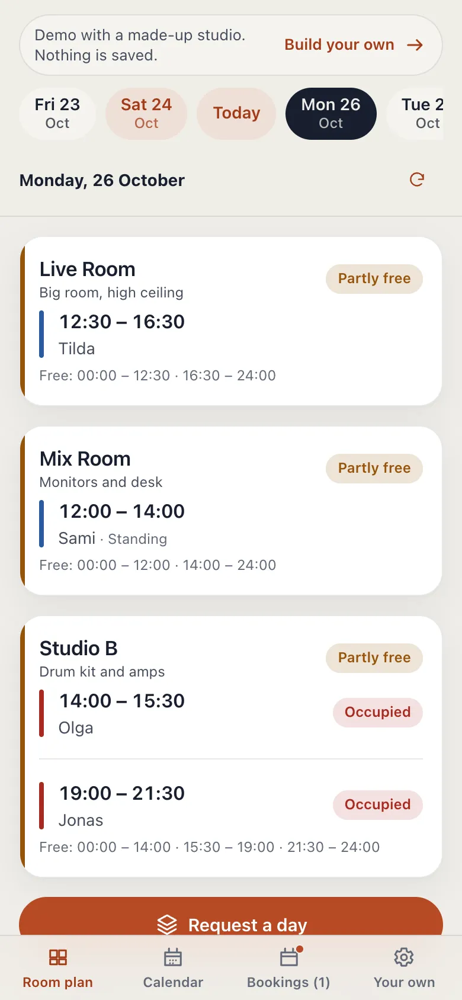
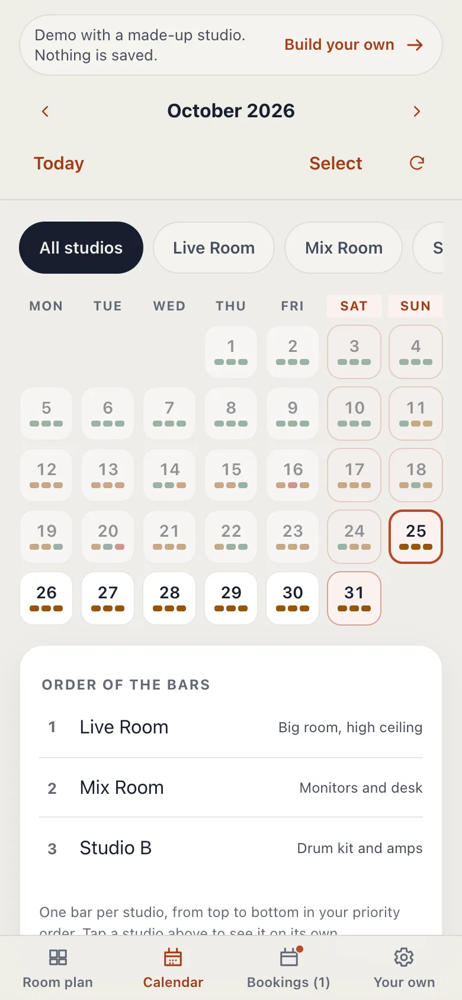
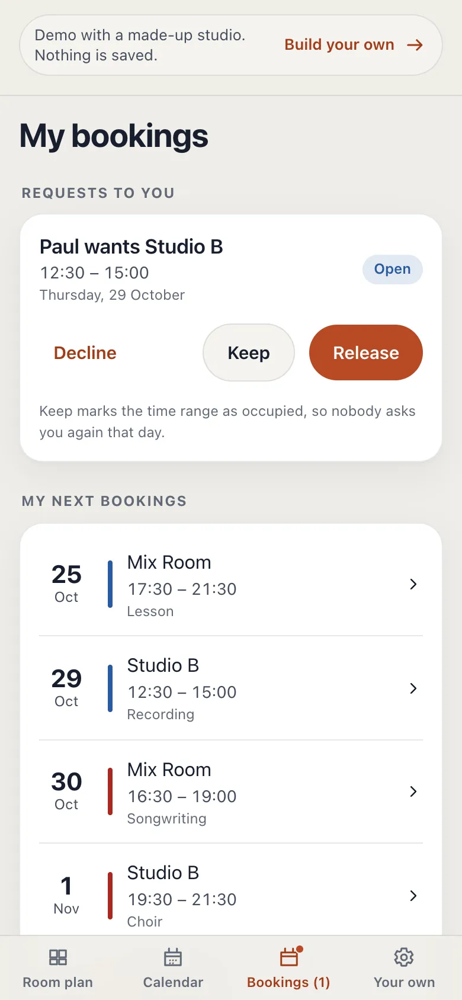

# Studio Raum

A shared room plan for a studio team. Everyone sees which room is free, books it, asks for a room someone else holds, and gives days back. It runs on your own free Cloudflare account, so your team's plan belongs to you.

**Try it first:** [sr.tbor.app](https://sr.tbor.app) shows a made-up studio. Nothing there is saved.

<p>
  
  
  
</p>

[](https://deploy.workers.cloudflare.com/?url=https://github.com/tibcz/studio-raum)

## What it does

- **Room plan.** Every room, every day: free, partly free, reserved or occupied.
- **Book** a room in half-hour steps, with a note if you like.
- **Ask for a room.** If a colleague has reserved it, you can ask for it. They release it or keep it.
- **Ask for any room.** A day request takes the best free room and asks for the ones you prefer. Whoever gives one up first, you move in.
- **Standing bookings.** "Mia, Studio A, every Tuesday 10 to 14" is entered eight weeks ahead by itself.
- **Release days** from the calendar, several at once.
- **Notifications** in the app, and on your phone if you allow them.
- **Export** everything as a file, and **delete** your data at any time.
- **No accounts, no passwords, no ads, no tracking.** People get in with a long secret, like a key.

## Set up your own, step by step

You need about 15 minutes. No programming and no terminal.

### What you need

- A free **GitHub** account ([github.com/signup](https://github.com/signup)). GitHub keeps your copy of the program.
- A free **Cloudflare** account ([dash.cloudflare.com/sign-up](https://dash.cloudflare.com/sign-up)). Cloudflare runs it on the internet.

It costs nothing. Cloudflare's free plan allows 100,000 requests a day, far more than a studio team uses.

### 1. Press the Deploy button

Press **Deploy to Cloudflare** above. Cloudflare opens. Sign in. When Cloudflare asks to connect to GitHub, allow it: Cloudflare then copies Studio Raum into your GitHub account and runs it from there.

### 2. Choose a setup password

Cloudflare shows a short form.

- Leave the project and Worker names as they are.
- In the field **SETUP_PASSWORD**, type a password you make up. You need it once, in step 3, so that nobody else can set up your Studio Raum before you do.

Press **Create and deploy**. After one or two minutes, Cloudflare shows your new address. It looks like `studio-raum.your-name.workers.dev`.

> If the form had no SETUP_PASSWORD field: open your Worker in Cloudflare, go to **Settings**, **Variables and Secrets**, press **Add**, choose **Secret**, name it `SETUP_PASSWORD` and enter your password. Studio Raum reminds you of this if it is missing.

### 3. Set up your team

Open your new address. Studio Raum asks for:

- the **setup password** from step 2,
- your **team's name**, **your name** and the **time zone**,
- **who runs this copy**: your name or your studio's name, an email address, and, if you use Studio Raum for your business, your postal address.

The last part fills in the privacy policy and legal notice of your copy (`/privacy` and `/legal`), because you are the one responsible for it. You can change these details later under **Settings**.

Studio Raum then shows two secrets: **your personal secret** and the **team secret**. Keep both in a password manager. Whoever has your personal secret is you in Studio Raum.

### 4. Invite your team

Send your address and the **team secret** to your colleagues. They open the address, choose **Join**, and enter the secret and their name. You approve them under **Settings**, and they can book.

Under **Settings**, **Joining and secret**, you decide whether new people need your approval before they can book, may only look, or cannot join at all. You can make a new team secret there at any time; the old one stops working.

## Updates

Your copy does not change by itself. When you want the newest version:

1. Open your copy on GitHub.
2. Go to **Actions**, choose **Update Studio Raum**, press **Run workflow**.

Cloudflare puts the new version online a minute later. Your team's data stays as it is.

## Good to know

- **It is yours.** Your copy and its data are on your Cloudflare account. The developer of Studio Raum has no access to it.
- **You are responsible for it.** If your studio uses Studio Raum for work, you handle your team's data. In the EU that makes you the controller under the GDPR. Studio Raum writes its privacy policy and legal notice from the details you entered, in German (binding) and English. They describe what the software does; whether they fit your situation is for you to check.
- **One team per copy.** A copy holds exactly one team, so it cannot turn into a public service for strangers by accident. If you really need more, set the variable `MAX_TEAMS` in Cloudflare.
- **Keep an export.** Studio Raum is free software without any guarantee. Now and then, save a copy: **Settings**, **Data**, **Export data**.
- **Deleting.** As the owner, **Settings**, **Data**, **Delete team** removes the whole team for good. To remove the copy itself, delete the Worker in Cloudflare.
- **Your own domain.** In Cloudflare, open the Worker, **Settings**, **Domains & Routes**, and add your domain.

## If something goes wrong

| What you see | What to do |
|---|---|
| "The setup password is not right" | Use the password from step 2. Forgot it? Change `SETUP_PASSWORD` in Cloudflare (Worker, Settings, Variables and Secrets). |
| "This copy has no setup password yet" | Add the secret `SETUP_PASSWORD`, see the note in step 2. |
| "This copy of Studio Raum already has its team" | Someone set it up already. If it was not you, delete the Worker in Cloudflare and deploy again with a new password. |
| A colleague lost their personal secret | As owner or admin: **Settings**, **Members**, block the old entry, and let them join again with the team secret. |
| You lost your own personal secret | Nobody can recover it, the developer included. If no other admin can let you back in, delete the team and set it up again. |
| The update fails | Nothing changed online. Open the failed run under **Actions** to see why, or ask in the issues. |

## Privacy and security, in short

- Secrets are never stored, only their keyed hashes. The server makes its own keys on first start.
- One cookie, for the session. No analytics, no third-party scripts, no external fonts.
- Failed sign-ins are counted to stop guessing; the IP address only enters as a hash and is gone after 15 minutes.
- Push notifications are end-to-end encrypted to the device (RFC 8291).
- Request logs are switched off in `wrangler.jsonc`.

## For developers

Cloudflare Workers with Durable Objects (one SQLite database per team), plain TypeScript in the browser, no framework.

```bash
npm install
cp .dev.vars.example .dev.vars   # set SETUP_PASSWORD
npm run serve                     # app and Worker at http://localhost:4182
npm test                          # Worker tests in the real runtime
npm run typecheck
```

- `src/domain` booking rules shared by browser and Worker
- `src/ui` the screens, built with `createElement` and `textContent` only
- `worker/do/team.ts` one Durable Object per team
- `worker/do/instance.ts` the copy's own settings: generated keys, the operator's details, the team limit
- `worker/legal.ts` the privacy policy and legal notice, filled with the operator's details

This repository is generated from the developer's monorepo. Pull requests are welcome; they are carried over by hand.

## Licence

MIT, see [LICENSE](LICENSE). The software comes as it is, without warranty. Studio Raum has no support; questions and bug reports go to the [issues](https://github.com/tibcz/studio-raum/issues), answered when there is time.
